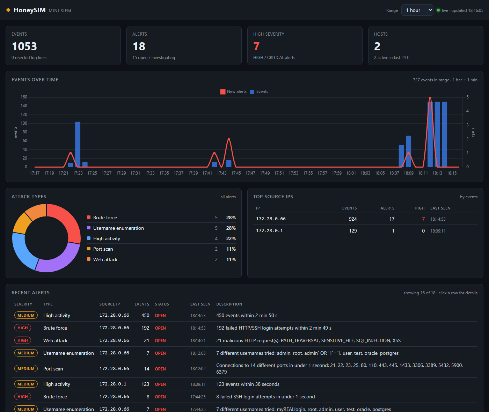
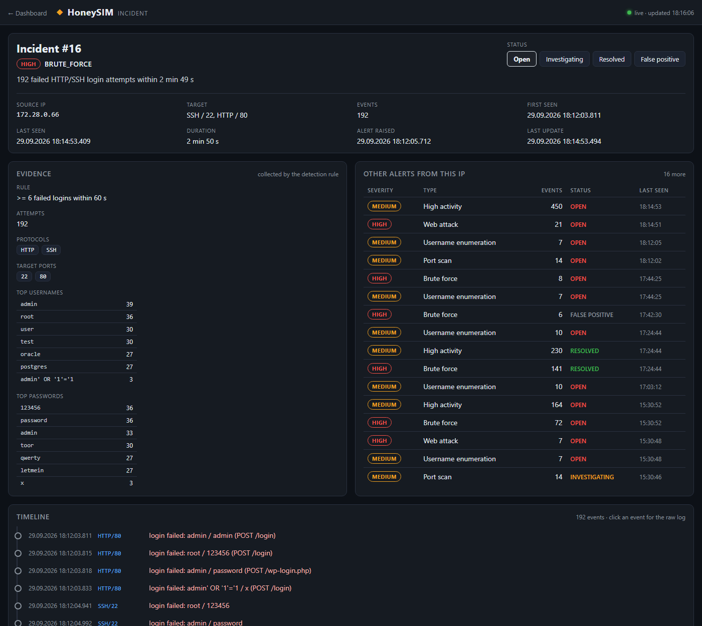

<div align="center">

  # HoneySIM 

</div>

Standalone, mini-SIEM running on Docker that acts as a **honeypot**, logs and stores all traffic events, flags attacks and displays it all on a dashboard.





I built it as a side project from what i learned during my studies.

## Quick start

**Requirements**: Docker + Docker Compose v2

```bash
docker compose up -d --build
```

|  |  |
|---|---|
| **Dashboard** | <http://127.0.0.1:3000> |
| API (Swagger) | <http://127.0.0.1:8000/docs> |
| Honeypot SSH | `ssh -p 2222 root@<your-PC-IP>` (from any device in your LAN) |
| Honeypot HTTP | `http://<your-PC-IP>:8080` (from any device in your LAN) |

### Local network access

The honeypot (SSH/HTTP) is reachable from other devices in your LAN out of the box. Dashboard and API always stay on
`127.0.0.1` - they have no authentication. Find your PC's address with `ipconfig`.

On Windows, allow the ports (2222, 8080) once in the firewall.


## Structure

| Kontener | Rola | Port na hoście |
|---|---|---|
| `honeypot` | „victim machine”: SSH, HTTP and decoy ports | 2222 → 22, 8080 → 80 |
| `collector` | monitors and parses the log, detects and records events and alerts atomically | — |
| `api` | REST API for database (FastAPI + SQLAlchemy) | 8000 |
| `dashboard` | nginx: dashboard files + reverse proxy `/api`, CSP header | 3000 |
| `simulator` | (optional) test attack scripts | — |

## Tests

```bash
# Performs bruteforce on SSH with different usernames
# (optional) parameter usernames - without it random usernames from a hardcoded pool
docker compose run --rm simulator python -m simulator.ssh_bruteforce --attempts 10 [--usernames a,b,c]
```

```bash
# Performs port scans 
# (optional) parameter ports - use it for range of ports to scan, without it scans ports from hardcoded list
docker compose run --rm simulator python -m simulator.port_scan [--ports 1-1024]
```

```bash
# Performs HTTP attacks on default port
docker compose run --rm simulator python -m simulator.http_attacks
```

## Future plans
Project can be quite easily extended with additional security monitoring capabilities.
